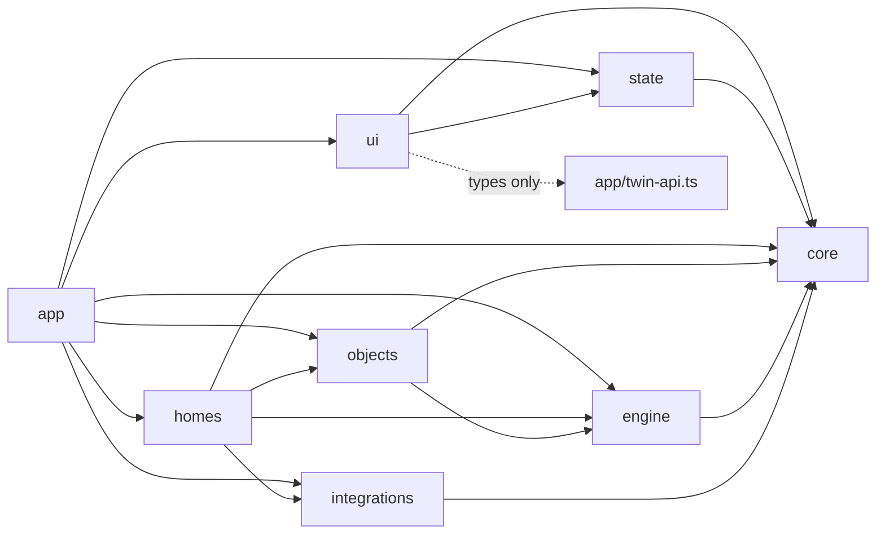

# Architecture

## Layers

```
src/
  core/           pure domain types and logic (no three.js, no DOM): topology, entities, scene types, twin-ux
  engine/         home-agnostic three.js runtime
    viewer/       PropertyScene (thin composition) + services/
    camera/ walkthrough/ lighting/ rendering/ cutaway/ annotation/ rooms/
    interaction/  InteractionRegistry + per-device handlers (doors, gates, bi-folds, golf sim, ladders)
    lod/ perf/ trade-views/ textures/ geometry/ usd/ util/
  integrations/   knx/ (bus emulator, circuits, topology, AI assistant), unifi/
  homes/crox-farmhouse/   scene profile, manifests, rooms/, structure/, heating/, security/
  objects/        reusable parametric object library (furniture, fixtures, joinery, vehicles, decor, devices)
  state/          Preact-signal stores, share-link codec
  ui/             Preact shell, panels and notes. ui/dev/ holds the legacy developer tools
  app/            composition root: bootstrap, TwinApi (UI-facing facade) and its adapter
  main.ts         entry point (treated as app)
tools/            dev-server/ (Vite plugins), snapshot/, lighting/, usd/, check-boundaries.mjs
```

## Dependency rule



| Layer | May import |
|---|---|
| `core` | nothing (no `three`, no `preact`) |
| `engine` | `core` |
| `objects` | `engine`, `core` |
| `homes` | `engine`, `objects`, `integrations`, `core` |
| `integrations` | `core` |
| `state` | `core` (no `three`) |
| `ui` | `core`, `state`, plus **type-only** imports of `src/app/twin-api.ts`. `src/ui/dev/**` may also import `engine` and `integrations` (legacy dev tools) |
| `app`, `main.ts` | anything |

`npm run check:boundaries` (`tools/check-boundaries.mjs`, no dependencies) enforces the rule
in CI. It scans static, side-effect and dynamic imports. It prints `file:line reason [specifier]`
for each violation and exits 1 if it finds any. When you add a new top-level directory under
`src/`, add it to `ALLOWED` in the script as well.

Why it matters: the UI must be testable and replaceable without WebGL, and the engine must stay
reusable for another home. Home-specific data (manifests, KNX circuit lists) belongs in `homes/`
or `integrations/`. The composition root in `app/` injects it into the engine.

## Key abstractions

### PropertyScene and its services (`src/engine/viewer/`)
`PropertyScene` owns the renderer, the scene graph and the frame loop. It is a thin composition
of focused services in `engine/viewer/services/`: render loop, camera, floors and cutaways,
rooms, graphics, trade views, annotations and devices. Each service owns one concern. The
public `PropertyScene` methods remain as delegates for tools and the snapshot harness. New code
should use the services directly or go through `TwinApi`.

### TwinApi (`src/app/twin-api.ts`, `src/app/create-twin-api.ts`)
TwinApi is the only engine surface the UI sees. The interface uses `core` types only and is
grouped into sub-APIs: `camera`, `floors`, `rooms`, `lighting` (KNX-backed), `devices`,
`graphics`, `trades`, `walkthrough`, `notes` and `dev`. Subscriptions return an `Unsubscribe`
function. `createTwinRuntime({ scene, knx, ... })` adapts `PropertyScene` and the KNX bus
controller and returns `{ api, tick(dt), dispose() }`. Bootstrap calls `tick` once per frame.

### RoomTracker (`src/engine/rooms/room-tracker.ts`)
RoomTracker works out the "current room". In walkthrough mode it uses the feet position and
commits immediately. In orbit mode it uses the pivot, filtered by floor view, with a 400 ms
dwell. An explicit navigator selection pins the room until the tracked point moves more than
2 m. It is pure apart from injectable timers, so it is unit-tested.

### PerformanceGovernor (`src/engine/perf/`)
The governor auto-tunes graphics. `device-tier.ts` picks an initial tier from the GPU string and
device caps, and `benchmark.ts` refines it. At runtime the governor samples frame times only
while the camera moves. When p95 runs high it steps the pixel ratio down in 0.1 increments, then
drops a tier. It steps up only after a long stretch of fast frames. Changes are applied only
when the camera is idle. It never touches lighting: tiers (`tier-settings.ts`) change resolution,
post-processing, shadow map size and LOD distances only.

### TradeViewController (`src/engine/trade-views/`)
`trade-classifier.ts` assigns each renderable object one of 16 trade categories using userData
flags, then head-noun matching on the hierarchical name chain. It is pure and unit-tested.
`trade-view-profiles.ts` maps each view (owner, architect, builder, electrician, plumber) to a
show, ghost, hide or highlight style per category. The controller applies a profile and
restores materials when the view changes.

### SceneBatchOptimizer (`src/engine/rendering/scene-batch-optimizer.ts`)
Runs once after the scene is built. It merges static meshes by material, and it keeps a fixed
per-tier budget of shadow-free point lights, so `NUM_POINT_LIGHTS` stays constant (no shader
recompiles, consistent lighting). The lighting consistency check covers its behaviour.

### InteractionRegistry (`src/engine/interaction/interaction-registry.ts`)
Holds the clickable devices (doors, garage door, gates, bi-folds, Frame TV, golf simulator,
ladders) under stable ids (`door:<mesh name>`, `garage-door`, ...). Per-device handlers live in
`interaction/handlers/`. KNX-backed pseudo-devices go through the same click path as meshes, so
the bus stays in sync. `SceneInteractionManager` is kept as a compatibility alias.

## How to…

### Add a room
1. Add the zone id to `RoomZoneId` in `src/core/types/topology.ts`. Add its definition (bounds,
   floor, building) to `ROOM_ZONES` in `src/integrations/knx/topology.ts`.
2. Build the geometry in `src/homes/crox-farmhouse/rooms/<floor>/<room>.ts` with the scoped
   builder context. Name meshes hierarchically (`room.element.part`) so the trade classifier
   and the USD exporter can read them.
3. Register the module in `src/homes/crox-farmhouse/zone-modules.ts`, plus camera presets if
   you want them.
4. Add a `CROX_ROOM_MANIFEST` entry in `src/homes/crox-farmhouse/room-manifest.ts` (label,
   group, circuits). That puts the room in the navigator and the room panel.
5. Run `npm run snapshot:check`. It fails as expected. Review the diff, then run
   `npm run snapshot:update` and commit `.snapshots/scene.snap`.

### Add a device
1. Build the mesh in the room module. Tag the clickable part with semantic `userData`
   (e.g. `isKNXSwitch`, `switchPa`, `isCarGate`) so the trade classifier picks it up as well.
2. Add a handler in `src/engine/interaction/handlers/` and register it with the
   `InteractionRegistry` under a stable id.
3. If the UI needs it, expose it through `TwinApi.devices` in `src/app/twin-api.ts` and
   implement it in `create-twin-api.ts`. UI code never imports the engine.

### Add a KNX circuit
1. Add the circuit to `CIRCUITS` in `src/integrations/knx/constants.ts` (id, label, group
   addresses, dimmable flag) and to its room's manifest entry.
2. Bind the fittings in the room module: put `circuitId` on the light group or fittings and add
   any point lights through the light groups, so the governor's point-light budget applies.
3. Add the circuit to the zone's scenes (`src/homes/crox-farmhouse/hud-model.ts`).
4. Run `npm run lighting:check` (lighting must depend only on KNX state + time of day) and the
   snapshot check.
